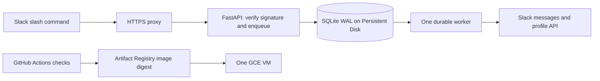

# Runtime and failure contract

The HTTP route performs bounded validation and one short `BEGIN IMMEDIATE` transaction before
acknowledging Slack. The enqueue runs off the HTTP event loop with eight concurrent slots,
50 ms admission wait, and a 500 ms SQLite busy timeout; rejected contention returns 503 without
an award. A real single-server test holds the writer lock and checks ten requests return within
2.5 seconds. Requests are keyed by SHA-256 of the signed timestamp/body. A replay cannot
increase a ledger count. Distinct deliberate commands with the same reason remain distinct awards.

One worker thread owns Slack side effects. An OS file lock rejects another worker process using
the same database directory. Readers use separate SQLite connections; transactions contain no
network I/O. WAL, FULL synchronization, foreign keys, and a 500 ms busy timeout are enabled.

Awards commit recognition, integer total, and delivery jobs atomically. Cancellation is giver-only,
transactional, retains audit data, and decrements once. The latest total is used for every name sync.
Base/desired names are durable before profile I/O, so remote success followed by a crash/timeout
does not append another suffix. Successful writes are checked by reading the Slack profile.

Slack and SQLite have no shared transaction. A post with a lost response, HTTP 5xx, `internal_error`,
or `fatal_error` may already exist; the job becomes `uncertain` and is never blindly replayed.
Known rate limits respect Retry-After. Other transient failures retry with bounded backoff.
Permission failures become `blocked`; recognition counts remain correct and commands expose the state.
Plain-text private replies use the command's response URL. Native tables use `chat.postEphemeral`
with channel/user IDs taken from the signed request; real Slack rejected table delivery through
the response URL during validation. Terminal command errors are returned to the caller explicitly.
Explicit channel access errors fail closed: history/thread links from an unavailable channel
are omitted while accessible leaderboard rows still render. Global token, scope, rate-limit,
and transient errors remain visible failures.
Reference: [chat.postMessage errors](https://docs.slack.dev/reference/methods/chat.postMessage/).

Costs come from one VM, its Persistent Disk, backups, image storage, and outbound network.
No separate database, queue service, dashboard, scheduled winner job, or load balancer is required.
Winners are computed on demand. Day/month/year/custom intervals are local calendar boundaries
converted to UTC; DST days can contain 23 or 25 hours.

Top 30 lookup uses an indexed integer total: approximately O(log users + 30). Period winners scan
active indexed recognitions in the chosen range and group recipients: O(rows in the period).
Slack API calls, especially membership pagination and profile edits, limit throughput before SQLite
does. This intentionally targets a single workspace with human-paced recognition. Do not run
multiple replicas or put SQLite on an object bucket, NFS share, or ephemeral container filesystem.

A VM failure causes downtime; acknowledged writes survive on the attached disk. A disk loss requires
restoring a tested backup. This architecture does not claim multi-zone availability or zero downtime.
